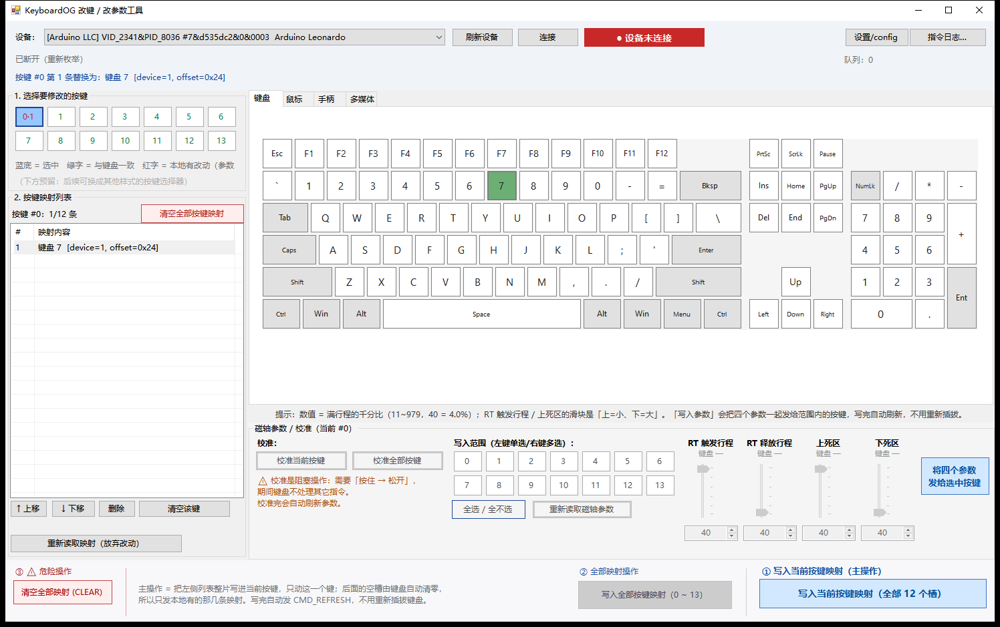
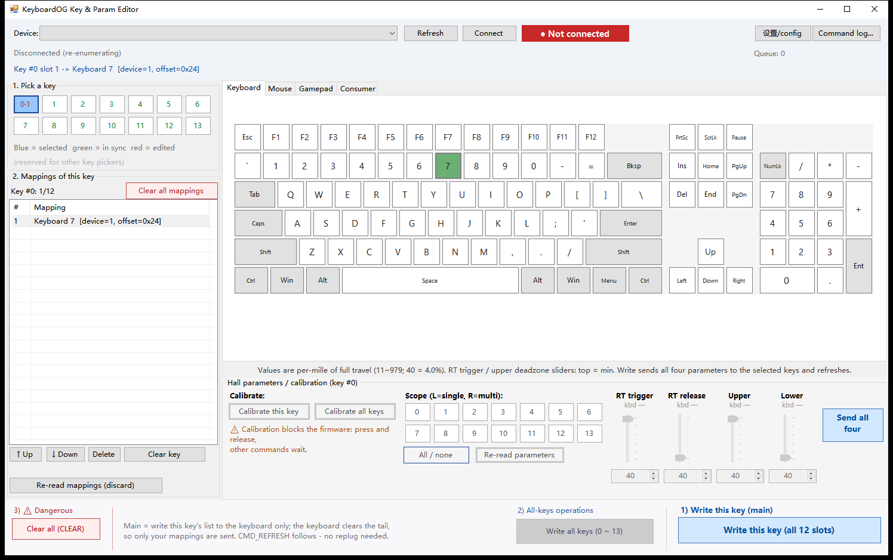
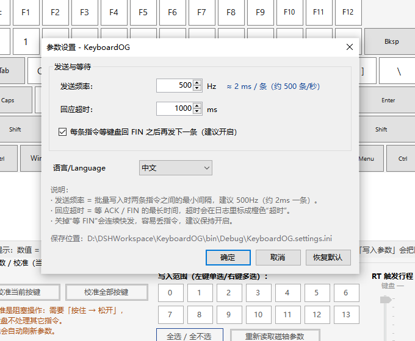

# KeyboardOG — 磁轴键盘改键 / 调参上位机

**中文** | [English](README.en.md)

[](#系统要求)
[](#系统要求)
[](#从源码构建)
[](#中文--英文界面)
[](#固件版本校验)

一个通过 USB HID 指令接口直接读写键盘配置的 Windows 上位机，用来修改**按键映射**、
调整**磁轴参数**、执行**校准**，并实时查看每一条下发指令的执行结果。

不需要安装驱动、不需要串口、不占用键盘的输入功能：

```
上位机 ──(HID Report ID 4，8 字节指令)──> 键盘固件
        <─(ACK / FIN / 查询结果 / 设备信息)─
```

配套固件：磁轴版本（本仓库的 `rtkb-layout-edited`）与六键矮轴版本（`6kb`），
两者共用同一套 Report ID 4 指令接口。

## 界面预览

主界面（中文）：



英文界面：



参数设置（支持中英即时切换）：



---

## 功能特性

### 连接与设备识别

- **只列出可用的指令接口**：枚举本机 HID 设备 → 过滤 `UsagePage=0xFF00 / Usage=0x01` 的厂商集合
  → 再对每个候选**发一条设备信息查询做探测**，只有真正回应的设备才会出现在下拉框里。
  这样触摸板之类的设备即使在描述符上"长得像"指令接口，也不会被误列。
- **连接后自动同步**：先读设备信息（按键数 / 是否磁轴 / 编码器数），再读全部映射与磁轴参数，
  界面上的内容就是键盘里的真实状态。
- **拔出自动断开**：监听系统设备变化并做一次轻量探活，连续两次无回应才断开，不会因为固件暂时忙而误判。

### 按键映射

- 四个可视化选键页签：**键盘 / 鼠标 / 手柄 / 多媒体**，直接点画面上的键即可映射。
- 修饰键（Ctrl / Shift / Alt / Win）自动换算 offset，落到 HID 报文的修饰键字节。
- 每个按键最多 12 条映射（与固件的 `MAXIMUM_BINDABLE_KEY` 对应），支持上移、下移、删除、清空该键。
- 按键按钮用颜色表示状态：**绿色 = 与键盘一致，红色 = 本地有改动尚未写入**。
- 统一的鼠标手势（四个选键控件一致）：

  | 操作 | 行为 |
  |---|---|
  | 左键点**已有**的映射 | 删除该条（"再点一次 = 取消"） |
  | 左键点**新**的映射 | 替换列表里选中的那一条；没有选中时追加 |
  | 右键 / Shift+左键 点**新**的映射 | 追加一条 |

### 写入策略：只发必要的指令

写入前会把"键盘上现在是什么"和"本地列表"做差，按情况选择最少的指令数：

| 情况 | 下发的指令 |
|---|---|
| 本地与键盘完全一致 | **一条都不发**，状态栏直接提示"无需发送" |
| 只在末尾追加了若干条 | 每条一个 `MAP_DO_APPEND` |
| 本地清空了该键 | 一条 `MAP_DO_CLEAR`（Byte6 = 0，清掉整个键） |
| 改动了中间某几条 | 只对变化的槽发 `MAP_DO_OVERRIDE` |
| 本地比键盘短 | 变化的槽发 `OVERRIDE` + 一条 `CLEAR` 从新长度处清到尾 |
| 还没同步过（不知道键盘内容） | 退化为整片重写，保证结果正确 |

举例：键盘上已有 12 条映射，只改中间一条 → **只发 1 条指令**（旧实现要发 12 条）。

每次写入成功后自动补一条 `CMD_REFRESH`，**改完不用重新插拔键盘**。

### 磁轴参数与校准

- 四个参数：RT 触发行程、RT 释放行程、上死区、下死区。每个参数一个垂直滑块 + 数值框，双向联动。
- **按按键分别保留本地改动**：改过的值切走再切回来仍是你的值（数值框标淡红），
  同时始终显示键盘里的真实值方便对照；只有写入成功或"重新读取磁轴参数"才会丢弃。
- 批量写入范围支持**单选 / 多选 / 全选**，按按键分别判定成功：四个参数都写成功才变绿。
- 校准：校准当前按键 / 校准全部按键，阻塞式操作，界面会随着固件逐个按键回报而更新进度。

### 指令日志

- 独立日志窗口，非阻塞、不抢焦点，重复打开不会闪烁。
- 记录每条指令的名称、详情、原始 8 字节、结果（待处理 / 已发送 / 已完成 / 超时 / 失败），
  底部有"发送 / 接收 / 完成 / 超时 / 失败"统计。
- 支持导出 CSV（默认保存到"文档"，目标文件只读会自动处理，目录不可写会改存并提示新路径）。

### 中文 / 英文界面

- 右上角"设置/config"里可即时切换中文与 English，**改了立刻生效**，不需要重启。
- 选择保存在 exe 同目录的 `KeyboardOG.settings.ini`，下次启动沿用。
- 新增界面文本后有自检脚本，防止漏翻（见[开发](#界面翻译与自检)）。

### 固件版本校验

- 设备信息报文的最后一个字节携带固件版本号，编码为 **2 | 3 | 3** 位：
  前 2 位 = 整数位，中间 3 位 = 小数点后第一位，最后 3 位 = 小数点后第二位
  （例如 `0b01_011_001` = `0x59` → **1.31**，`0x41` → **1.01**）。
- 软件侧维护一张"软件版本 ↔ 支持的固件范围"表；连接后立刻判断并显示：
  - 支持：显示 `固件 1.01 / 软件 1.01`；
  - 固件过老：红字 `固件版本过老，请更新固件`；
  - 固件过新：红字 `固件版本过新，请更新软件`；
  - 并附一行 `版本不匹配可能导致意料之外的问题`。

  当前软件 `1.01` 支持固件 **1.00 ~ 1.57**（见 `Protocol/VersionInfo.cs`）。

### 其它细节

- 通信层单线程串行化，界面线程不做任何阻塞 IO，HID 应答超时也不会卡界面。
- 超时/错位后自动纠正：只认"序号对得上"的 ACK / FIN，必要时先清空读缓冲，避免污染下一条指令。
- 修复"程序换目录后第一次打开界面缺块"：窗口显示后按 120 / 400 / 1200 ms 各补一次重绘。

---

## 快速开始

### 1. 连接键盘

1. 点「刷新设备」，在**设备**下拉框里选中你的键盘（只有真正回应设备信息的设备才会出现）。
2. 点「连接」。连接成功后会自动读取设备信息、全部映射与磁轴参数。
3. 如果状态栏提示"没有收到设备信息"，说明固件较旧或不是配套固件，见 [FAQ](#faq)。

### 2. 改一个键

1. 左侧点按键编号（例如 `0`）。
2. 在右侧页签里点想要映射到的键：**左键替换 / 右键追加**；再点一次已有的映射即可删除。
3. 点最右侧的 **「写入当前按键映射」**（主操作）。只会改动这一个键，不影响其它按键。

### 3. 调磁轴参数

1. 在"写入范围"里选中要改的键（左键单选、右键多选、也可全选）。
2. 拖动滑块或直接输入数值（数值是满行程的千分比，`40` = 4.0%）。
3. 点「将四个参数发给选中按键」，每个键四个参数都写成功才会变绿。

---

## 系统要求

| 项目 | 要求 |
|---|---|
| 操作系统 | Windows 10 / 11（x64） |
| 运行时 | .NET Framework 4.6.1 或更高 |
| 权限 | 普通用户即可；若设备被其它程序独占，尝试以管理员运行 |
| 硬件 | 配套固件的磁轴键盘 / 六键键盘（需实现 Report ID 4 指令接口与设备信息帧） |

> ⚠️ 进程必须运行在 **x64** 下：原生库 `HIDComm.dll` 是 x64 的，工程里已设置
> `<Prefer32Bit>false</Prefer32Bit>`，自行改工程时请勿改动。

---

## 从源码构建

### 1. 原生库（首次必须先生成）

```powershell
cd KeyboardOG.Native
powershell -ExecutionPolicy Bypass -File build.ps1
# 输出 bin\HIDComm.dll（x64），工程会自动复制到 bin\Debug|Release
```

### 2. WinForms 工程

用 Visual Studio 打开 `KeyboardOG.sln`，或命令行：

```powershell
& "D:\Microsoft VS\MSBuild\Current\Bin\MSBuild.exe" `
  KeyboardOG\KeyboardOG.csproj /t:Build /p:Configuration=Release
```

> 命令行构建若报 `MSB4018 / X509Store 拒绝访问`，是工程里的 ClickOnce 清单签名在找证书；
> 加 `/p:SignManifests=false` 即可，不影响最终的 Authenticode 代码签名。

### 3. 一键编译 + 签名

```bat
sign.cmd            :: 编译 Release → 签名 → 验证
sign.cmd -NoBuild   :: 只签名（用 VS 编好的产物）
```

每次重新编译都会丢掉上一轮的 Authenticode 签名，发布前跑一次 `sign.cmd` 即可。
自签名证书只能消除"未知发布者"，消除不了 SmartScreen 信誉拦截 —— 详见 [signing/README.md](signing/README.md)。

---

## 目录结构

```
KeyboardOG/
├─ Form1.cs / Form1.Designer.cs   主窗口：设备、按键选择、映射列表、选键区、执行条
├─ Keyboard.cs                    键盘可视化选键
├─ MouseControl.cs                鼠标可视化选键
├─ GamepadControl.cs              手柄可视化选键
├─ ConsumerControl.cs             多媒体可视化选键
├─ HallParamControl.cs            磁轴参数 + 校准
├─ LogForm.cs / CommandLogView.cs 指令日志窗口与视图
├─ PickerSupport.cs               选键控件统一接口、事件、配色与绘制
├─ SettingsForm.cs                参数设置（含语言切换）
├─ Language.cs                    中/英文本对照表 + 运行时翻译
├─ Protocol/
│  ├─ HidNative.cs                HIDComm.dll 的 P/Invoke 声明
│  ├─ HidTransport.cs             单线程串行化的 HID 通信层（队列 + 异步包装）
│  ├─ ProtocolDefs.cs             协议常量、8 字节指令构造、名称表
│  ├─ KeyMapModel.cs              映射列表模型
│  ├─ MappingWriter.cs            写入指令最小化（APPEND / OVERRIDE / CLEAR 决策）
│  ├─ VersionInfo.cs              固件/软件版本号解析与兼容性表
│  ├─ CommandLog.cs               日志条目与仓库
│  └─ AppSettings.cs              设置读写（ini）
├─ signing/                       代码签名脚本与证书说明
├─ tools/Check-Localization.ps1   界面翻译自检
└─ docs/                          截图、技术笔记（协议速查、踩坑记录）
```

---

## 协议速查

指令与回传都走 **Report ID 4**，数据 8 字节。完整的字节表、ACK/FIN 校验规则、
offset 取值范围、EEPROM 布局与固件踩坑记录在
[**docs/technical-notes.md**](docs/technical-notes.md)。

三条最容易踩的坑，先在这里点一下：

1. **一条指令回两帧**：先 ACK 再 FIN。只读一帧会把 FIN 留给下一条指令，表现为"改键丢一半"。
2. **设备信息帧没有 FIN**：查询设备信息时要用"收到 `0xFF` 帧"作为结束条件。
3. **固件会丢弃重复指令**：所以每条指令的第 8 字节写一个自增序号。

---

## FAQ

**Q：设备列表是空的 / 找不到我的键盘**

- 固件必须实现指令接口（`UsagePage=0xFF00 / Usage=0x01`）与设备信息帧；旧固件不回应探测，就不会出现在列表里。
- 确认键盘没被其它程序（串口监视器、HID 测试工具）独占。
- 可以尝试以管理员身份运行。

**Q：连接后指令超时、"没有收到 FIN"**

- 设置里把「回应超时」调到 1000~2000 ms；固件若开着 `DEBUG`（`Serial.print` 会阻塞），
  在没有串口监视器时每条打印可能阻塞数百毫秒，建议发布固件关闭 `DEBUG`。
- 不要同时开 Arduino 串口监视器。

**Q：写入成功但键盘没变**

- 新版固件收到 `CMD_REFRESH` 后会重新载入配置，正常不需要插拔；
  若固件较旧，请重新插拔键盘。

**Q：多媒体键按一下就连续触发很多次**

- 这是固件在重复上传同一份 consumer 报文导致的：键盘/鼠标位是状态语义，重复上报无副作用，
  而 Windows 的 consumer 通道是"每收到一份带该位的报文就派发一次动作"。
  固件侧改为"仅状态变化时上传"即可，与上位机无关。

**Q：提示"未知发布者" / "Windows 已保护你的电脑"**

- 前者装一次证书即可（`signing\Install-Trust.ps1`）；后者是 SmartScreen 信誉，自签名证书无法消除。

**Q：第一次从别的目录打开，界面缺一块**

- 已修复：窗口显示后会补几次重绘。若仍出现，请反馈复现步骤。

---

## 界面翻译与自检

界面文本集中在 `Language.cs`：中文字面量留在源码里，切换语言时由 `L.Apply(控件)` / `L.T()` 现场查表
（表是双向的，中↔英可反复切换）。

新增中文文本后跑一次自检，它会列出所有没有英文对照的字面量：

```powershell
powershell -NoProfile -ExecutionPolicy Bypass -File tools\Check-Localization.ps1
```

- 退出码 `0` = 全部有翻译，`1` = 有遗漏（清单写入 `tools/localization-report.txt`）
- 行尾注释中的中文不会误报；`#` 开头的 `.ini` 注释会跳过
- `L.T("中文", "English")` / `L.F("中文", "English", ...)` 内联双语的调用自带英文，不要求进表

---

## 相关工程

| 工程 | 说明 |
|---|---|
| `rtkb-layout-edited` | 磁轴键盘固件（按键映射、磁轴参数、校准、EC11 编码器） |
| `6kb` | 六键矮轴键盘固件 |
| `KeyboardOG.Native` | HID 原生库（枚举、选择设备、发送 / 读取报文） |

---

## 致谢

- HID 原生库由 `WindowsGUIIncludes` 的 `HIDComm` 复制而来，仅修正了 `CancelIo` 后未等待取消完成的问题。
- 感谢在真机上反复验证映射、参数、校准与固件版本协议的过程中提供的反馈。

> 本仓库未附带开源许可证；如需以 MIT / Apache-2.0 等方式开源，请在根目录添加 `LICENSE` 文件。
